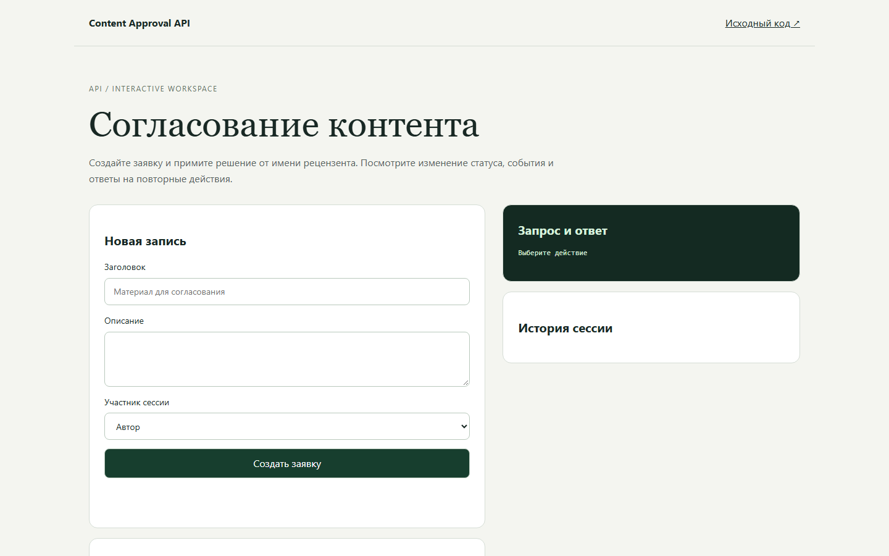
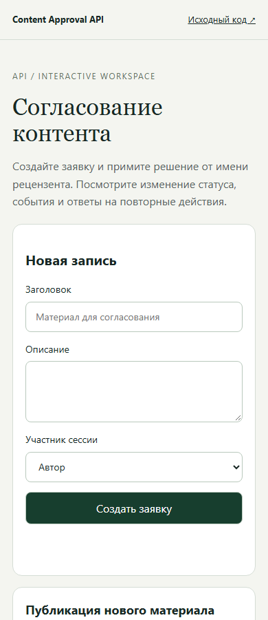

# Content Approval API - согласование контента

Согласование заявок внутри рабочего пространства и надёжное хранение событий для последующей доставки.

[Открыть проект](https://memorim.github.io/content-approval-api/)

## Интерфейс





## Возможности

- Создание, одобрение, отклонение и отмена заявок, фильтры и аудит.
- Идемпотентное создание и атомарное сохранение решения с outbox-событием.
- Аренда событий, ограниченные повторы, очередь исчерпанных попыток и получатель с дедупликацией.

## Стек и устройство

Python, FastAPI, SQLAlchemy, Alembic; SQLite локально, PostgreSQL через Docker Compose.

## Ключевые решения

- `app/service.py` меняет финальный статус условным UPDATE только из pending. Устаревшая ORM-сессия не может перезаписать итог; аудит и событие создаёт только победившая операция.
- Idempotency-Key проверяется без обрезки; повтор должен совпадать по участнику и неизменяемым полям, иначе 409.
- Статус, аудит и outbox фиксируются одной транзакцией. Миграции Alembic сохраняют записи; токен аренды запрещает старому исполнителю подтвердить новую доставку.
- Стабильный ID события позволяет получателю исключать дубли. Сбой между приёмом и подтверждением может вызвать повтор; после пяти попыток требуется явная постановка в очередь.

## Локальный запуск

Python 3.12.14, как в `.python-version`. Перед установкой зависимостей активируйте виртуальное окружение.

```bash
python -m venv .venv
# Windows: .venv\Scripts\activate
# Linux/macOS: source .venv/bin/activate
python -m pip install -c requirements-lock.txt -r requirements.txt
alembic upgrade head
uvicorn app.main:app --host 127.0.0.1 --port 8000
```

Команда запуска привязывает API к локальному адресу 127.0.0.1.

## Настройки

Доступные параметры перечислены в [.env.example](.env.example). Секреты храните вне Git. Порядок загрузки настроек и необязательные службы описаны в [технической документации](docs/TECHNICAL.md).

## Данные и обновления

Выполните команду миграции из инструкции перед запуском API. Существующие записи сохраняются; тесты проверяют обновление зафиксированной предыдущей версии.

## Проверки

```bash
python -m pytest -q
python tests/check_contract.py
python tests/check_upgrade.py
python -m pip check
```

Проверяются решения из устаревших сессий, идемпотентность, аренды, повторная доставка и дедупликация. CI PostgreSQL проверяет конкурирующие решения и равные/конфликтующие ключи.

CI устанавливает зависимости по зафиксированным версиям и запускает настроенные проверки. Отдельная проверка документации находит неверные локальные ссылки и изображения. Проверка уязвимостей учитывает известные проблемы на момент запуска.

## Ограничения

- Личность и права проверяются сервером по Bearer-токену. Произвольные identity-заголовки не дают доступа. Вход через внешний OIDC-провайдер не настроен.
- Проверки PostgreSQL используют независимые сессии; это проверки корректности, а не подтверждение производственной нагрузки.
- Адрес webhook задаёт оператор. Интеграции с почтой, Slack и Telegram не подключены. Успешная доставка после исчерпания попыток не гарантирована.

## Документация

[Результаты аудита](docs/AUDIT_2026_10.md) · [Техническая документация](docs/TECHNICAL.md) · [Пример запроса и ответа](docs/API_EXAMPLE.md) · [Конкурентные проверки PostgreSQL](docs/POSTGRES_CONCURRENCY.md) · [История изменений](CHANGELOG.md)

## Интерактивный просмотр

В браузере можно пройти основной сценарий и увидеть форму запросов и ответов. Изменения хранятся в памяти вкладки и сбрасываются при перезагрузке. Этот просмотр не подключён к серверной БД, токенам и доставке webhook. Для проверки серверных гарантий используйте локальный запуск и автоматизированные тесты выше.

Сборка: `python scripts/build_demo.py`. Проверка: `node --test demo/demo.test.mjs`.

## Серверная идентификация

API требует `Authorization: Bearer <token>`. Заголовки X-User-Id, X-Workspace-Id и X-Actions больше не определяют личность или права. Это несовместимое изменение для старых клиентов.

Администратор создаёт отдельный случайный токен для каждого пользователя (`python -c "import secrets; print(secrets.token_urlsafe(32))"`) и вне Git задаёт APP_AUTH_TOKENS: JSON-объект, где ключ — SHA-256 токена, значение — `{"workspace_id":"ws_1","user_id":"usr_1","actions":["approval:read"]}`. Передавайте пользователю только его токен; используйте HTTPS. Не храните токен в URL. Удаление записи отзывает доступ; перезапустите процессы после обновления окружения. Без настроенного реестра доступ закрыт. Самостоятельная регистрация и внешний провайдер входа не подключены.

Доставка событий уже поддерживает повторные попытки и ручной возврат из очереди ошибок: `python -m app.outbox --retry EVENT_ID`. Инструкция и гарантии доставки — в docs/OUTBOX.md.

### Пользователи и отзыв доступа

Задайте APP_AUTH_DATABASE=/secure/auth.sqlite3. Выпуск: `python -m app.credentials --database /secure/auth.sqlite3 issue --workspace ws_1 --user usr_1 --actions approval:read,approval:create --days 30`. Команда показывает секрет один раз; в БД хранится только SHA-256. Передайте его пользователю по защищённому каналу. Отзыв: `python -m app.credentials --database /secure/auth.sqlite3 revoke TOKEN_HASH`. Отзыв применяется ко всем процессам при следующем запросе без перезапуска. У токенов есть срок действия; файлы создаются с правами 0600. Старый APP_AUTH_TOKENS поддерживается, если APP_AUTH_DATABASE не задан.
